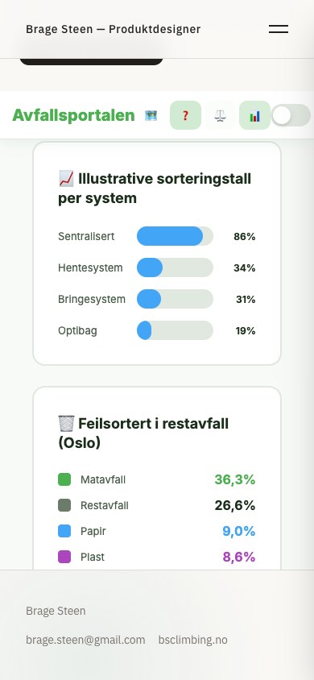
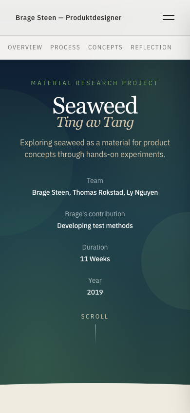

# J1 – gjennomføring og kontroll, 23. oktober 2026

Tilbake til [hovedplanen](../../../PLANS.md).
Gren: `codex/portfolio-j1-kvalitet`, basert på `origin/main` med planverket som egen første commit.
Status: implementert og kontrollert lokalt. Produksjon må skilles fra denne forhåndsvisningen.

## Leveranse

- Seksjonslenker oppdaterer URL-en og fungerer ved direkte åpning, refresh og tilbake/frem.
  Sticky toppmeny måles; bildeforskyvninger korrigeres i et avgrenset tidsvindu og stopper
  ved brukerinteraksjon. Observatører/timere ryddes ved navigasjon.
- Lukket mobilmeny er `inert` og skjult for tilgjengelighetstreet. Escape, fokusretur,
  Tab-avgrensning, lenkevalg og historikknavigasjon håndteres.
- Bachelor: 60 deltakere er forklart med rapportens to workshopgrupper; sitatet er forkortet
  til dokumentert tekst; forventet verdi skilles fra resultater. Video-knappen beskriver video.
- Headset: individuell NTNU-oppgave, 2021, emne og fire måneder er bekreftet av Brage.
  Produksjons-/pristall er briefmål. Ukjent draft-vinkel er utelatt.
- Seaweed: testmetodeansvar synliggjort, generelle miljø-/materialpåstander avgrenset,
  pressforsøket satt i verkstedkontekst, og mobiloverlapp fjernet.
- Avfallsportalen: tydelig prototypemerking, tilgjengelige faner og svar, tastaturbetjente
  infokort, synlig quizfokus, lesbare grafetiketter og melding ved samme kommune.
  Udokumenterte vinnerrangeringer, elefantsammenligning og Paris-attribusjon er fjernet.
- Korte norske forklaringer og lenke til frittstående demo er lagt til Avfallsportalens prosjektside.

## Oppgavefordeling og modellbruk

Brage ba om Luna-subagenter og et nøkternt forbruk. Tre uavhengige oppgaver ble fordelt
med isolert kontekst (`fork_turns: none`) og tydelig eierskap til filer:

| Oppgave | Modell / innsats | Ansvar |
|---|---|---|
| Navigasjon | GPT-6 Luna / max | Tre felles komponenter og meningsfulle regresjonstester |
| Prosjektfakta | GPT-6 Luna / high | Avgrenset faktarydding i tre eksisterende caser |
| Avfallsportalen | GPT-6 Luna / max | Én HTML-demo og den omsluttende React-siden |
| Sluttkontroll | Gjenbruk av Luna / high | Read-only kontroll av navigasjon og demoendringer |

Hovedagenten beholdt ansvar for gren/commits, avhengigheter, integrasjon, spørsmål til Brage,
kontrollscript, produksjonsbygg, nettleserprøver og dokumentasjon. Subagentene byttet ikke
gren og gjorde ingen egne commits. Arbeidet i andre prosjektrepoer var lesing av kilder.

Faktaryddingen fikk én målrettet redaksjonell justering: beskriv det prosjektet faktisk
viste, uten å fylle porteføljen med gjentatte forbehold. Den uavhengige kontrollen fant
manglende fokusretur ved Tilbake med åpen meny. Dette ble rettet og fikk både unit-test
og en ekte nettleserkontroll. Ingen nye subagenter ble startet for disse oppfølgingene.
Tokenforbruk per agent er ikke målt; loggen dokumenterer arbeidsdelingen, ikke en beregnet besparelse.

## Bekreftet av Brage i denne runden

- Bachelorarbeidet var felles gjennom hele prosjektet.
- I Seaweed hadde Brage særlig ansvar for å utvikle testmetodene.
- Headset var solo, NTNU 2021, Design for Industrialization, fire måneder.
- Søker produktutvikling, produktdesign, industridesign og fullstack-/AI-implementering.
- Tilgjengelig fortløpende. Styrke: fra idé til en prototype som fungerer på kort tid.

De siste profilopplysningene er tatt inn i planverket for J2. Nåværende arbeidsforhold
og siste CV-datoer er fortsatt uavklart. Ingen jobbhistorikk er funnet på.

## Verifikasjon

- `npm ci`: eksisterende låsefil brukt; ingen avhengighetsoppgradering.
- `npm run build`: bestått.
- `npm test`: fem tester bestått, inkludert fire nye navigasjonsregresjoner.
- `npx tsc --noEmit -p tsconfig.app.json`: bestått.
- `npm run lint`: ingen feil; sju eksisterende Fast Refresh-advarsler i urørte UI-byggeklosser.
- Nettleserkontroll mot produksjonsbygget med `wrangler dev`, faktisk Chrome og 1440/390 px:
  **20 kontrollgrupper bestått, ingen JavaScript-feil.**
- Skjermbilder av mobilgraf, Seaweed-topp og quizresultat er visuelt kontrollert.

Kontrollscriptet er [scripts/kontroller-portefolje.mjs](../../../scripts/kontroller-portefolje.mjs).
Kjør et ferdig bygg med Wrangler på port 8787, og deretter:

```bash
PLAYWRIGHT_CHANNEL=chrome node scripts/kontroller-portefolje.mjs
```

Utelat `PLAYWRIGHT_CHANNEL` dersom Playwrights egen Chromium er installert.
Resultater og øvrige kontrollbilder ligger i ignorert `output/playwright/j1/`.

Kontrollgruppene dekker fem prosjektruter, tre direkte fragmenter med refresh,
ankerklikk/tilbake/frem, lukket meny og Escape/fokusretur, Tilbake med åpen meny,
åtte reisesteg frem og tilbake, ti quizsvar (også tastatur), forventet 1/10,
omstart, ulike/like kommunevalg, lesbar 19 %-etikett og infokort med Enter/Space.

To kontrolltilpasninger ble gjort underveis: en kort siste seksjon kan bare justeres
så langt som dokumentets bunn tillater, og den innebygde demoen må rulles inn i visningen
før kontrollene betjenes. Dette ble håndtert i testen, uten tvungne klikk eller å omgå feil.

## Synlige eksempler





## Forhåndsvisning og grenser

Vite med live oppdatering kjører lokalt på http://127.0.0.1:8080/.
Produksjonslik kontroll brukte et separat Wrangler-bygg på port 8787.
Sites er ikke nødvendig for denne runden; repoet og eksisterende Cloudflare-oppsett beholdes.

J2 gjenstår: gjennomgående norsk prosjekttekst, forside/profil, full CV, norske URL-er,
delingsmetadata, bildestørrelser og HTTP/www-opprydding. Nye GripSense-/Caddy-caser er ikke
implementert i J1. Full ekstern Sketchfab-interaksjon, alle nettlesere/skjermlesere,
full butikk-/betalingsflyt og faktavalidering av prototypens statistikk er ikke bekreftet her.
