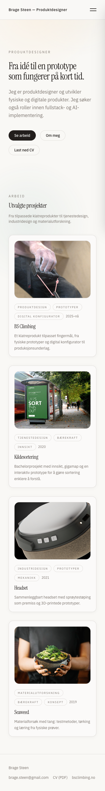
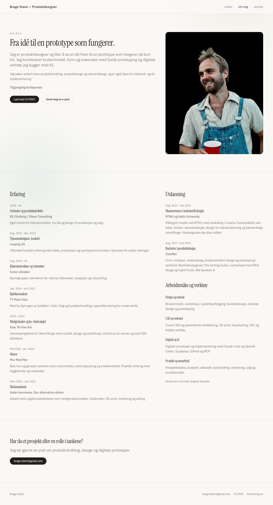
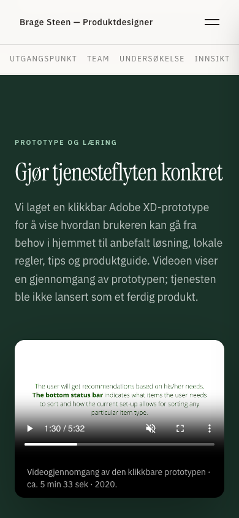

# J2 – portefølje for jobbsøking

Dato: 2026-10-23. Gren: `codex/portfolio-j2-jobbsoking`. Bygger på J1, merget i PR #25.
Dette er lokal implementering og kontroll samt Cloudflare-forhåndsvisning; J2 er ennå ikke merget til produksjon.
Domenevideresendingen nedenfor er en separat, allerede aktiv Cloudflare-endring.

## Arbeidsdeling

Tre Luna-agenter med high-innsats arbeidet med avgrensede casefiler: bachelor, Headset/Seaweed
og forside/BS Climbing. De ble også brukt til kilde- og innholdsreview. Hovedagenten håndterte
felles ruting, metadata, CV, bildebehandling, Cloudflare og samlet nettleserkontroll.
Ingen subagent merget eller pushet; integrasjonen og verifikasjonen ble gjort samlet.

## Endret innhold

- Forsiden viser produktdesigner og rask vei fra idé til fungerende prototype. Fire hovedcaser:
  BS Climbing, Kildesortering, Headset og Ting av tang. Avfallsportalen nås fra bachelorcasen.
- BS Climbing leder med fysisk produkt, måling, parametrisk form og prototyping. Brage har
  bekreftet rundt 40 prototyper med variasjoner i tekstur, proporsjoner, toleranser og avrundinger.
- Bachelorcasen er forkortet og skrevet på norsk, med felles ansvar for Brage og Regina.
  Originale engelske sitater, skjermbilder og vedlegg er tydelig merket. Historien fra 2020
  er skilt fra Avfallsportalen, en senere demonstrator fra 2026.
- Headset har H1 og norsk introduksjon på første skjerm. Brages soloprosjekt ved NTNU i 2021,
  fire måneder, med sprøytestøping som premiss. Vinkler, toleranser og proporsjoner er bekreftet
  som hovedtemaer i den fysiske utprøvingen. Produksjonsmål er fortsatt merket som oppgavepremisser.
- Ting av tang er kortere og beskriver testmetoder, tørking og sprekker, uten udokumentert miljøeffekt.
- Om meg og en offentlig CV på to sider bruker samme publiseringsgrunnlag i
  `src/content/profil.json`. Kilden er den nye SixSides-CV-en i `_innboks/cv/`.
  NTNU/Aalto august 2021–mai 2022 og ufullført master er oppgitt. Brage har godkjent ordlyden.
  Publiseringskopien har e-post; telefon, adresse og fødselsdato er utelatt. Originalen er urørt.

Brages nye prototypeopplysninger beskriver arbeidets omfang og temaer. Det finnes ennå ikke
et dokumentert før/etter-eksempel med et bestemt mål eller kundesitat; dette er ikke diktet opp.

## Medier og personopplysninger

46 prosjektbilder er eksportert som nettversjoner under `nett/`. Sammen med portrett og
nytt delingsbilde har alle 48 registrerte bilder maksimalt 2400 px på lengste side og er
under 500 kB. Foto/renders bruker JPG, tekniske tegninger PNG. Dimensjoner legges inn gjennom
`Prosjektbilde`. Portrettet gikk fra 1,88 MB til omtrent 210 kB.

En metadatakontroll av alle 168 lesbare bilder i `public/` fant ingen EXIF, IPTC eller XMP
etter rydding. Også eldre offentlige kopier med GPS ble renset; originaler i `_innboks/`
er ikke endret. Den ubrukte filen `finger-width22.jpg` er en gammel tekstfil, ikke et bilde;
den brukes ikke i sidene og beholdes til referansebasert opprydding i J4.

- Offentlig CV: `public/cv/brage-steen-cv.pdf`, to sider, omtrent 99 kB. Begge sider er rendret
  og visuelt kontrollert. Tekstuttrekk viser korrekt utdanningsstatus og ingen telefon/adresse/fødselsdato.
- Bachelorrapport: engelsk, 106 sider, 19,4 MB. Publiseringskopien har ryddet PDF-metadata.
  Tekstsøk fant ikke privat e-post eller telefon. Side 4 har underskrifter; side 26–27 har
  gjenkjennelige hjemmebesøk/husholdningsopplysninger. Dette ble lagt frem for Brage, som sa:
  «tenker det går helt fint. behold rapport, gigamap og video».
  Ikke alle rapportfotografier er visuelt undersøkt; dette er ikke en full anonymiseringskontroll.
- Gigamap: egen PDF på omtrent 1,5 MB, med fullstørrelsesbildet bevart for zoom. PDF-en er rendret.
- Video: full gjennomgang, 5 min 32,6 sekunder, omtrent 20,6 MB. Start, pause og søk til
  90 sekunder er kontrollert ved begge skjermbredder.
- Headset: begge gallerier virker; tegningene har separate fullstørrelseslenker. Sketchfab lastes
  først ved behov og har en ekstern reservelenke. «3D» ble startet i den vanlige innebygde
  nettleseren, og modellen kom frem. Rotasjon via dra ble ikke verifisert på grunn av begrenset
  iframe-inndata i testverktøyet; mobil-WebGL er heller ikke bekreftet.

## Norske adresser og deling

Sju norske ruter leverer egne sidetitler, beskrivelser, absolutte delingsbilder og canonical
allerede i HTML, i tillegg til metadata ved navigasjon i React. Bygget lager sitemap og
16 permanente videresendinger fra gamle adresser med/uten avsluttende skråstrek.
Query-parametere beholdes. Ukjent URL gir en forståelig 404 med HTTP 404.

HTML-filer genereres etter Vite-bygg av `scripts/generer-sider.mjs`. Dette viderefører Vite;
det er ingen Astro-migrering. CV-lenken returnerer en faktisk PDF, også gjennom Cloudflare.

## Videofeil og avgrenset Worker

Kontrollen fant at statisk videoservering ignorerte `Range` og returnerte hele filen med 200.
Chrome rapporterte `seekable: [0,0]`, og forsøk på å hoppe til 90 sekunder gikk tilbake til start.

`worker.js` kjøres bare på prototypevideoens eksakte sti. Den bruker ASSETS og Cloudflares
Cache API til å servere reelle byteområder med 206. Cache-nøkkelen inneholder filens ETag,
slik at en ny videoversjon ikke får gammelt innhold. Øvrige sider og ressurser serveres statisk.
Kaldt cachetreff må lagre videostrømmen før byteområdet kan returneres. Bare videokall bruker
Worker-kjøringer; det legges ikke Worker-kode foran hele porteføljen.

Integrasjonstesten kontrollerer faktiske bytes i et midtparti, suffix-range og 416 utenfor filen.
`If-Range` med matchende ETag støttes; en datovalidator som ikke kan sammenlignes faller trygt
tilbake til full 200. Dette er ingen generell medieserver.

Grunnlag: [Cloudflare Cache API](https://developers.cloudflare.com/workers/runtime-apis/cache/),
[selektiv Worker-ruting](https://developers.cloudflare.com/workers/static-assets/).

## Domeneendring – kontrollert i produksjon

Cloudflare Single Redirect «Kanonisk adresse: HTTPS uten www» er aktiv:

```text
Filter: (http.host in {"bragesteen.no" "www.bragesteen.no"} and (not ssl or http.host eq "www.bragesteen.no"))
Mål: concat("https://bragesteen.no", http.request.uri.path)
Status: 301
Preserve query string: ja
```

Følgende tre kall med `/projects/headset?fra=jobb` ble kontrollert: `http://bragesteen.no`,
`http://www.bragesteen.no` og `https://www.bragesteen.no`. Alle returnerte 301 til
`https://bragesteen.no/projects/headset?fra=jobb`. Den kanoniske HTTPS-adressen returnerte 200.
Regelen kan reverseres ved å slå den av i domenets Redirect Rules; ingen DNS-poster ble endret.

## Lokal verifikasjon

- `npm run build`, TypeScript og fem enhetstester: bestått.
- Lint: ingen feil; sju eksisterende Fast Refresh-advarsler i eldre UI-byggeklosser.
- 22 hovedkontrollgrupper: norske ruter, levert metadata, 301-er, 404, PDF, alle fem caser,
  bilder, H1, horisontal scroll, fragment/direkte/refresh, historikk, mobilmeny/fokus,
  Avfallsportalens åtte steg begge veier, ti spørsmål, forrige spørsmål, forventet resultat,
  omstart, kommunevalg, tema, grafer og tastaturkort.
- Sju mediekontrollgrupper: video-range, forside/Om meg og prosjektklikk, 200 % tekst,
  begge Headset-gallerier, video start/pause/søk og PDF-vedlegg på 1440 og 390 px.
- Redusert bevegelse respekteres også ved forsinkede kortanimasjoner. To reelle feil ved
  forstørret tekst ble rettet: minstekolonnebredde i prosjektgrid og lang e-postknapp.

Kjøring mot et ferdig bygg:

```bash
npm run build
npx wrangler dev --ip 127.0.0.1 --port 8788 --inspector-port 9231
PLAYWRIGHT_CHANNEL=chrome node scripts/kontroller-portefolje.mjs http://127.0.0.1:8788
PLAYWRIGHT_CHANNEL=chrome node scripts/kontroller-medier.mjs http://127.0.0.1:8788
```

Port 8787 var allerede i bruk av GripSense; den prosessen ble ikke rørt. Vite-forhåndsvisningen
på http://127.0.0.1:8080/ beholdes med live oppdatering. Testutdata ligger i ignorert `output/`.

## Visuelle eksempler







## Cloudflare-forhåndsvisning

Kodecommit `0de429b9ea58e21a4d5938560b683e5424d56708` er pushet i PR #26.
Cloudflare-build `5f9f5cb3-42d0-46af-bf91-520b0b76a81f` bestod.
[Åpne forhåndsvisningen](https://codex-portfolio-j2-jobbsoking-brage-steen-product-designer.brage-steen.workers.dev).
Alle 22 hovedkontrollgrupper og sju mediegrupper består også der, uten JavaScript-feil.
Full rapportnedlasting: HTTP 200, 19 385 749 bytes, 22,48 sekunder. SHA-256 er identisk
med lokal publiseringskopi: `01b653d11bf8e7df1b4c2d8c1fbf1a109afa8aa2e83aa8a07c5c1b2ea9d9fa0c`.
Dette er et stort valgfritt vedlegg; den offentlige CV-en er til sammenligning omtrent 99 kB.

Medietesten hadde først en tidsgrense på 30 sekunder for hver full rapportnedlasting.
Rapporten returnerte korrekt 200/PDF/filstørrelse, men traff tidsgrensen.
Testen er derfor delt: innholdstype/PDF-signatur kontrolleres én gang, mens full nedlasting
og identisk filinnhold kontrolleres separat. Video og gallerier testes fortsatt i begge størrelser.

## Før produksjonsmerge

- [x] Kontroller publisert forhåndsvisning og separat full rapportnedlasting.
- Brage vurderer tekst, offentlig CV og prosjektfortelling før merge til `main`.
- Etter merge: kontroller samme sentrale flyter i produksjon. J1 Worker-versjon
  `4169610c-8688-4e4a-b7c8-943bb80e6c42` er forrige verifiserte produksjonsversjon.
- Nye GripSense-/Caddy-caser hører til senere faser og er ikke lagt til i J2.

Full butikk-/betalingsflyt, ekstern datavalidering av Avfallsportalen, alle nettlesere,
skjermlesere og full tilgjengelighetssertifisering er utenfor kontrollen som er dokumentert her.

## Produksjon 2026-10-24

Brage godkjente publisering med «push og fortsett». PR #26 ble merget som
`e280808417f67dd59d6f7f794bbe1e2927461e49`. Cloudflare-build
`2abb5ec7-1288-42e6-934c-ac842972aae4` bestod. Alle 22 hovedkontrollgrupper og sju mediegrupper
bestod også på https://bragesteen.no, med 1440/390 px og ingen JavaScript-feil.
Produksjonsutdata ligger i `output/playwright/j2-produksjon/`.

Aktiv, kontrollert Worker-versjon etter J2: `ba71a57c-8721-4a9e-aad3-1ee52ab2ed29`
(`wrangler deployments list`, 2026-10-24). Denne kan brukes som tilbakeføringspunkt for neste fase.
