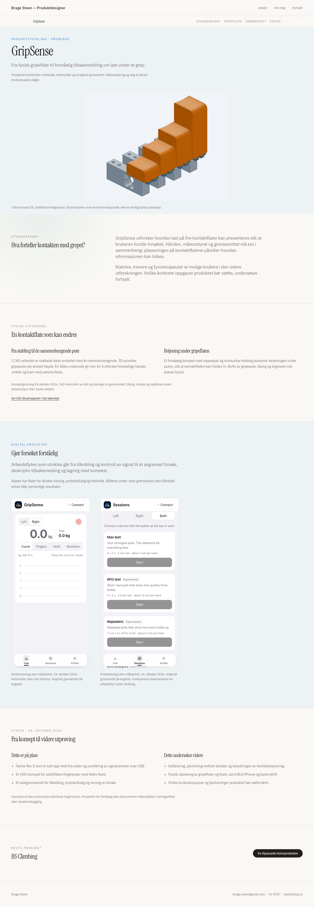
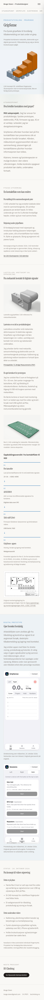

# J3 – GripSense-utkast

Dato: 2026-10-24. Gren: `codex/portfolio-j3-gripsense`, fra oppdatert produksjon etter J2.
J2 er publisert gjennom PR #26; alle 29 kontrollgrupper består på bragesteen.no.

## Retning og arbeidsdeling

Visuell idé: rolig produktcase med eksisterende typografi og en blå aksent fra GripSense.
En CAD-illustrasjon knytter fysisk gripeflate til appens arbeidsflyt. Ingen ny global designretning.

Innhold: pågående prosjekt → spørsmålet som undersøkes → utskiftbar kontaktflate →
appvisninger → datert status/neste utprøving → BS Climbing som neste prosjekt.
Interaksjon: eksisterende ProjectBar, redusert-bevegelse-tilpasset inngang og fullstørrelseslenker.

To Luna-agenter med high-innsats arbeidet uavhengig med kildegrunnlag og medieinventar.
De ble også brukt til ren lokal appfotografering og målrettet fakta-review. Hovedagenten
skrev siden, behandlet bilder, integrerte ruting og gjennomførte samlet kontroll.
GripSense-kildefilene og originalmaterialet er ikke redigert.

## Hva utkastet viser

- Ett mekanikkvalg: fra stablede deler til én sammenhengende, utskiftbar gripepute.
- Et foreløpig låsekonsept med betjening under kontaktflaten.
- Aktuelle appflater i tom tilstand, uten personlige resultater eller tilkoblet enhet.
- Første Rev E-kort med fire celler og USB-overføring, basert på nyere prosjektstatus.
- Åpne spørsmål om fysisk utprøving, kalibrering, kanalpåvirkning, brukssituasjon og målgruppe.

Ruten er `/prosjekter/gripsense`. Den er foreløpig utelatt fra forsideutvalget og sitemap,
og leverer `noindex, follow`. Dette er redaksjonell kladdestatus, ikke privat tilgang.
Brages konkrete rolle og fysiske prototypehistorie er etterspurt; de er ikke funnet på.

## Kilder og bilder

Kilder under `~/Documents/GripSense/`:

- `docs/source-of-truth/{PRODUCT_SCOPE,ROADMAP,VALIDATION_PLAN,METRICS_AND_PROTOCOLS,METRIC_REGISTRY}.md`.
  Roadmap 2026-10-23 og AGENTS beskriver kort 1 med fire celler og USB. Eldre README/validering
  beskriver tidligere oppstart uten fingre og har foreldet appstatus. Casen gjør ingen påstand
  om lukkede valideringsporter, pålitelig måleopptak, treningseffekt eller klinisk nytte.
- `hardware/mekanikk/adjustable-finger-pad/{DESIGN_BRIEF,README}.md` og
  `STEP/modular_pad.step`: CAD-konsept 05. Én sammenhengende pad, felles feste, fri kontaktflate.
  Statisk geometri er kontrollert i kildeprosjektet; låsing, ergonomi, styrke og slitasje er åpne.
- CAD-snapshot fra modellen, standardkamera, 1600 × 1200. Lagret kildeutdata var
  `/private/tmp/gripsense-modular-pad.png`. Publiseringskopi:
  `public/projects/gripsense/nett/fingerputer-konsept-05.jpg`.
- Appbilder tatt 2026-10-24 fra eksisterende lokal Vite på `http://localhost:5173`,
  i ren Playwright-kontekst, 390 × 844. API-ruter ble blokkert, cloud session/outbox var fraværende,
  og ingen forsøk ble startet/lagret. Eksisterende Vite ble ikke stoppet eller endret.
  Publiseringskopier: `app-live.png` og `app-protokollvalg.png` i samme nettmappe.

Kildesøk i GripSense, relevant Portolfio-mappe og porteføljens innboks fant ikke foto av
selve fysiske grep-/sensoroppstillingen. Gamle PCB-renderinger og pitch-figurer med
udokumenterte målepåstander ble valgt bort. Ingen måledata eller private profiler er publisert.

Alle tre bilder er under 70 kB, maksimalt 1600 px, og behandlet med sharp uten metadata.
Bildeoversikten kan nå også regenereres fra ferdige `nett/`-bilder:
`node scripts/optimaliser-bilder.mjs --bare-dimensjoner`.

## Lokal kontroll

- Bygg og TypeScript: bestått. Fem enhetstester består; lint har ingen feil og sju eldre UI-advarsler.
- Sju nettleserkontrollgrupper består på 1440/390 px: levert metadata/noindex, bilder,
  H1, horisontal scroll, ankerklikk, direkte lenke, refresh, tilbake/frem, 200 % tekst,
  fullstørrelsesbilder og lenke til BS Climbing. Ingen JavaScript-feil.
- Desktop og mobil er visuelt kontrollert. Lang tekst ved forstørring fikk eksplisitt ordbryting.
- Lokal livevisning: http://127.0.0.1:8080/prosjekter/gripsense.

```bash
npm run build
npx wrangler dev --ip 127.0.0.1 --port 8788 --inspector-port 9231
PLAYWRIGHT_CHANNEL=chrome node scripts/kontroller-gripsense.mjs
```

## Før casen kan bli hovedprosjekt

- Brage bekrefter eget ansvar og eventuelle bidragsytere.
- Brage velger aktuelle fysiske bilder og to–tre konkrete prototypeendringer/læring.
- Skill dagens fysiske oppsett fra CAD-konseptet og eventuelle eldre revisjoner.
- Kontroller oppdatert forhåndsvisning og få godkjenning før produksjonsmerge.

Det er fortsatt mulig å bruke den publiserte J2-porteføljen i søknader mens dette ferdigstilles.

## Visuell kontroll





## Cloudflare-forhåndsvisning

PR #27 er pushet som kladd. Cloudflare-build `31faa227-e888-4bef-802c-edb3b81c59a5`
bestod for første kodecommit `5e3b36f`. Alle sju kontrollgrupper bestod også i
[forhåndsvisningen](https://codex-portfolio-j3-gripsense-brage-steen-product-designer.brage-steen.workers.dev/prosjekter/gripsense).
En siste lokal høydejustering sørger for at CAD-bildet og merkingen vises i første skjerm:
kontrollert ved 1280 × 720 og 1280 × 1000, samt 390 × 844 i kontrollscriptet.
J3 er ikke merget; `/prosjekter/gripsense` gir fortsatt 404 på hoveddomenet.
