# Kontroll av bragesteen.no – 22. oktober 2026

Tilbake til [hovedplanen](../../../PLANS.md). Dette er en kontrollrapport, ikke en liste over
rettelser som allerede er publisert. Funnene er ført inn i de respektive prosjektplanene.

## Omfang og metode

Brukerreise: forstå Brages profil → velge prosjekt → se prosess/bevis/demo → finne CV/kontakt.
Den utvidede testen ble gjort i Codex sin innebygde nettleser ved omtrent 400 px bredde.
Skjermbilder nedenfor er lagret fra denne testen og visuelt kontrollert. Nettleseren endret
bredde mellom enkelte flater; det er ikke brukt som bevis på en full desktopgjennomgang.

Tidligere samme dag i denne samtalen ble de fem prosjektrutene testet på 1440 og 390 px
med klikk, direkte URL og refresh: ingen ødelagte bilder i hovedsidene, JavaScript-feil
eller horisontal sidescroll ble funnet. Utvidelsen her tester innhold og interaksjoner som
den første kontrollen ikke dekket, og finner blant annet feil ved **fragmentlenker**.

Cloudflare-status fra første kontroll: aktiv sone, rot og www knyttet til riktig Worker,
aktive TLS-sertifikater og grønt produksjonsbygg. HTTP videresendes ikke til HTTPS, og www
videresendes ikke til rotdomenet. Dette er gjenstående opprydding, ikke en hostingstans.

## Oversikt over steg

| Steg | Brukeroppgave | Tilstand |
|---|---|---|
| 1 | Forside, navigasjon og prosjektvalg | Prosjektene åpner; lukket mobilmeny har skjulte tastaturstopp |
| 2 | BS Climbing og lenke til butikken | Åpner; presentasjonen vektlegger utvikling/AI mer enn produktdesign |
| 3 | Bachelor, prototypevideo og gigamap | Video spiller og fullstørrelsesbilde åpner; fakta og knappetekst må ryddes |
| 4 | Headset, gallerier og 3D | Galleriknapper reagerer og 3D laster; intro/H1 og produksjonspåstander trenger arbeid |
| 5 | Avfallsreise, quiz, sammenligning og dashboard | Hovedflytene virker; datagrunnlag og enkelte mobil-/tilgjengelighetsdetaljer er svake |
| 6 | Seaweed og refleksjon | Innhold/ankerklikk fungerer; fragmentlenke, mobiloverlapp og påstander må korrigeres |
| 7 | Om meg, CV og kontakt | Om meg/e-post finnes; CV er ikke tilgjengelig fra siden |

## 1. Forside og navigasjon

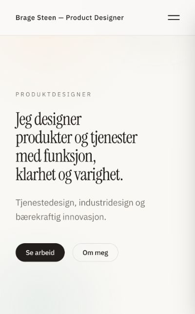

**Det som fungerer:** tydelig navn, kort introduksjon og lenker til arbeid/Om meg.
De fem prosjektkortene gir fungerende innganger. Mobilmenyen kan åpnes og lukkes.

**F01 – tastaturfokus utenfor skjermen (må rettes).** Med menyen lukket går Tab fra
«Åpne meny» til «Lukk meny», Arbeid, Om meg og Kontakt i panelet utenfor skjermen.
DOM-kontroll viste x ≈625 for lukkeknappen og x ≈433 for lenkene i en visning på ca. 400 px.
Fiks synlighet/fokusbarhet (for eksempel betinget rendering eller inert) og test fokusretur/Escape.
Dette er kontrollert med tastatur, ikke bare antatt fra et skjermbilde.

**F02 – fragmentlenker (må rettes).** Direkte åpning av `#model`, `#prototype` og `#reflection`
lander øverst på prosjektsiden. Observerte målposisjoner var ca. 3380, 15987 og 11258 px under
visningens topp, mens `scrollY` var 0. Seaweed-feilen ble også kontrollert etter oppdatering.
Klikk på den interne menyen ruller til seksjonen, men `ProjectBar.tsx` hindrer standardlenken
og oppdaterer ikke fragmentet. Håndter hash ved innlasting/navigasjon og fast toppmeny samlet.

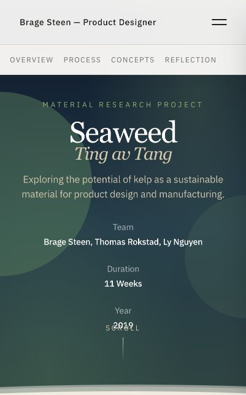

**F03 – språk/rolle.** «Product Designer» i toppteksten og flere engelske prosjektmenyer
bryter med norsk hovedpresentasjon. Gjør felles navigasjon konsekvent.

## 2. BS Climbing

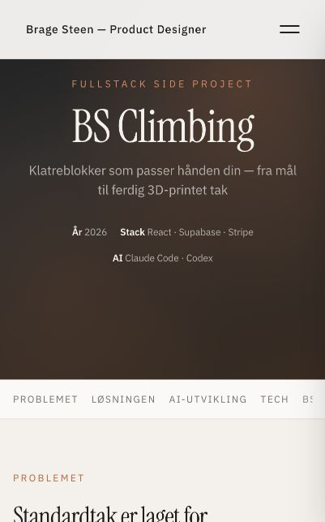

**Bestått:** case åpner, produktbilder vises og butikklenken åpner bsclimbing.no.
**F04 – posisjonering:** «Fullstack Side Project», Stack/AI-fakta og «Claude Code og Codex
som utviklingsteam» gir feil tyngdepunkt for produktdesignerrollen. Vis egne valg og fysisk
prototyping før verktøyene. Det er en innholdsjobb, ikke en grunn til å bytte rammeverk.

Butikkens kjøpsflyt, eksisterende handlekurv, betaling og ordre ble ikke endret eller testet.

## 3. Bachelor / The Sorting Guide

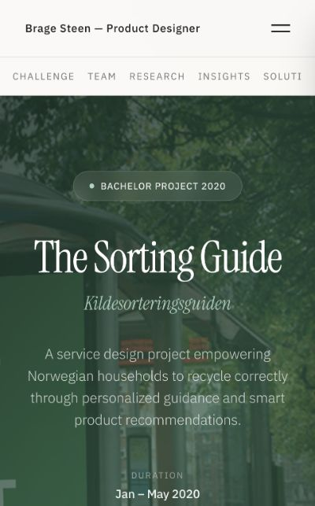

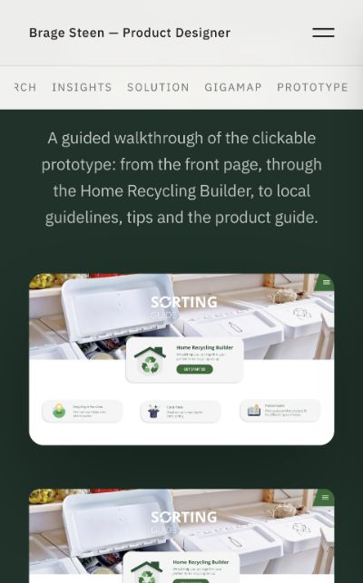

**Bestått:** intern Prototype-lenke ruller til videoseksjonen. Videoen ble startet, og
DOM viste `paused=false`, `readyState=4`, posisjon ca. 30,8 sekunder og varighet ca. 332,6 sekunder.
Dette er bevis på avspilling, ikke bare at en MP4-lenke svarer. Full gjennomvisning og søking
ble ikke testet. Gigamap åpnet i ny fane som et bilde på 3200 × 7357 px.

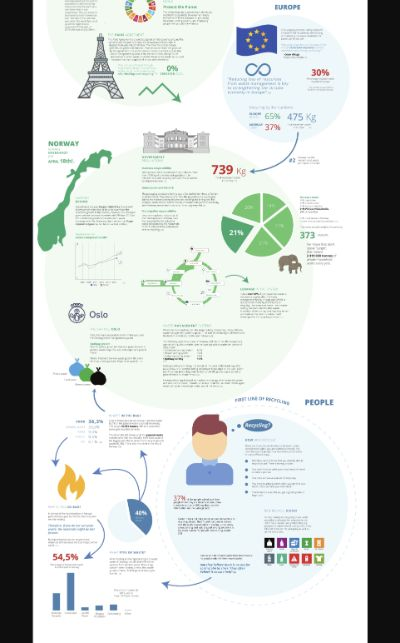

**F05 – «Try Prototype» er misvisende.** Handlingen fører til en video. Bruk «Se prototypegjennomgang».
**F06 – kildesjekk:** siden viser «67+» workshopdeltakere; originalrapport s. 35 beskriver
27 + 30 + 3. Rapport s. 95 støtter den korte IKEA-uttalelsen, men ikke nettsidens ekstra setning.
Disse er dokumenterte avvik mot den kontrollerte kilden, ikke bevis på at annet grunnlag aldri har eksistert.
**F07 – fortelling:** forklar Brages individuelle bidrag, hold 2020 og 2026 fra hverandre,
og merk historiske tall. Behold den engelske originalrapporten som vedlegg til norsk presentasjon.

## 4. Headset

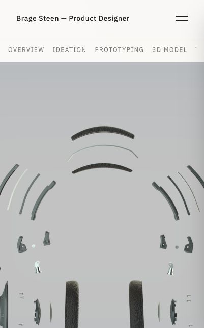

**F08 – inngangen mangler kontekst.** Ingen H1; første skjerm er et høyt, beskåret bilde.
Dette gir særlig på mobil lite informasjon om oppgaven eller Brages rolle. Legg til tittel/ingress
og tilpass bildehøyde/utsnitt.

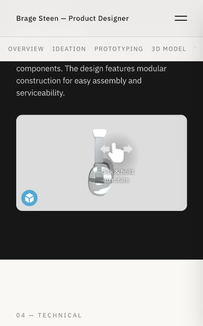

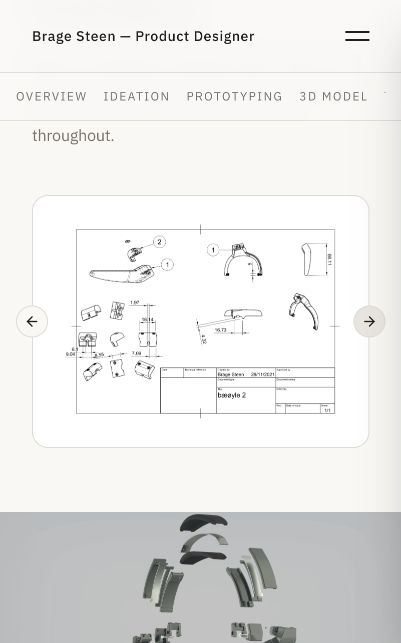

**Bestått:** prototype- og tegningsgalleriets Neste-knapper reagerer; Forrige blir aktiv.
Sketchfab viser modellen etter start. En dra-operasjon kunne ikke gjennomføres gjennom
nettleserverktøyet, så rotasjon er fortsatt et konkret testpunkt. En skjult feilmelding i
embed-DOM ble ikke tolket som en feil på siden; skjermbildet viste en innlastet modell.

**F09 – faktapresisjon:** «100,000 units» må forklares som brief/produksjonsmål. «2% draft angles»
må kontrolleres mot tegninger; ikke automatisk oversettes til 2°. Uformell prototyping er ikke
dokumentert ergonomisk validering.
**F10 – medievekt:** produksjonskilden inneholder `details-render.png` på 6 377 158 byte.
Dette er filstørrelse fra Git, ikke en måling av total lastet sidevekt eller Core Web Vitals.
Optimaliser bildeformat/størrelse og last 3D ved behov.

## 5. Avfallsportalen

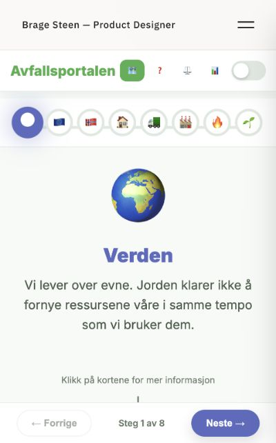

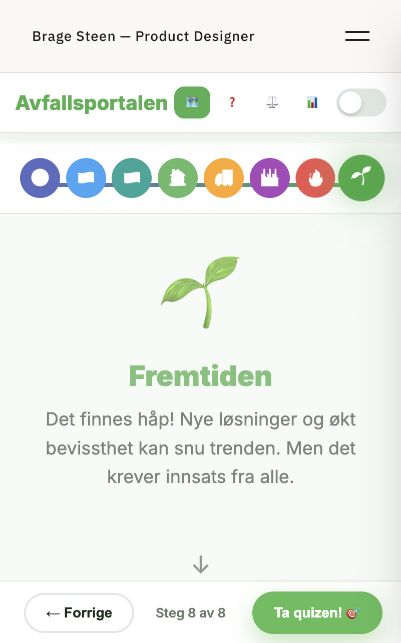

**Bestått:** Verden → Europa → Norge → Hjemme → Innsamling → Sortering → Behandling → Fremtiden.
Siste knapp åpner quiz. Alle ti spørsmål ble besvart; både riktig og feil tilbakemelding ble vist.
Ni feil og ett riktig svar ga **1/10**. «Prøv igjen» gikk tilbake til ubesvart spørsmål 1.

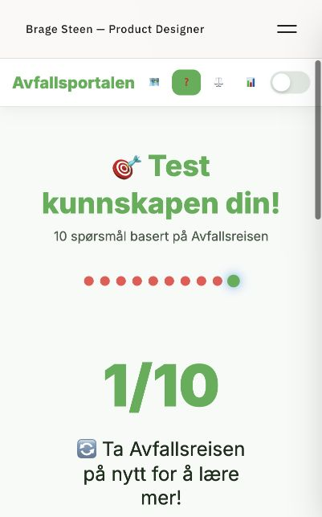

**Bestått:** endring fra Oslo til Bergen oppdaterte sammenligningskort og forskjeller.
Dashboardet og detaljene for avfall per person kunne åpnes.

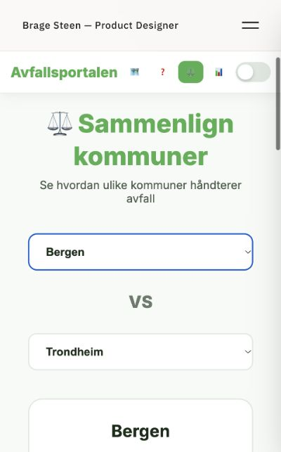

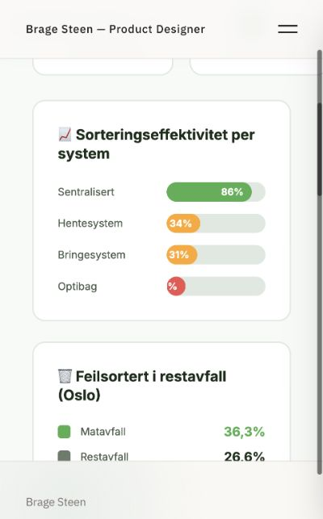

**F11 – data og troverdighet (må ryddes).** Kommunetall er hardkodet og presenteres med
«vinner» og dagens-formuleringer uten synlige kildeår. Vis historiske/illustrative data som
nettopp det. Ingen tall er eksternt faktavalidert i denne kontrollen. Regneeksempelet
«2,4 millioner tonn = 373 elefanter» er åpenbart uegnet; det impliserer over 6 400 tonn per elefant.
**F12 – graftekst:** 19 %-søylen viste bare «%» i den smale visningen. Legg tall utenfor smale søyler.
**F13 – tilgang/leseflyt:** fanene er kun emoji, og flere klikkbare quiz-/infokort er tekst/
div-struktur. Test og bygg ordentlige tastaturkontroller. Resultatet beholdt en lav scrollposisjon;
vi måtte rulle opp for å se poengsummen. Nytt spørsmål/resultat bør få tydelig start og fokus.

Utestående: alle steg bakover, endring av gamle svar, alle kommunepar/lik kommune,
alle detaljkort, temapersistens, skjermleser og alle tastaturkontroller.

## 6. Seaweed

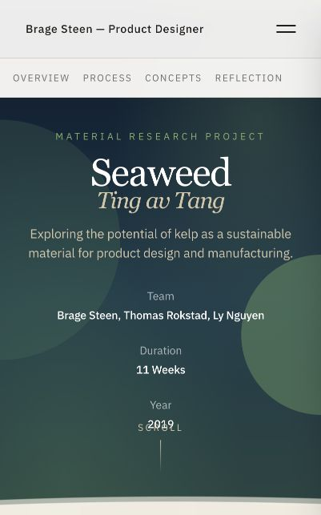

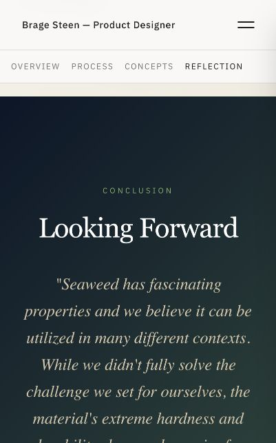

**Bestått:** case og bilder vises; klikk til Reflection ruller til avslutningen.
**F14 – mobil:** årstall og SCROLL-markør overlapper i toppen. Fjern dekorativ markør eller tilpass høyden.
**F15 – påstander:** teksten om nedbrytning, CO₂, gjødsel, økonomi og «15t» trenger avgrensning.
Originalrapporten gir en god historie om eksperimenter og læring. Pressforsøket på s. 56 er et
verkstedforsøk, ikke en generell materialspesifikasjon. Skill konsepter fra testede egenskaper.

## 7. Om meg, CV og kontakt

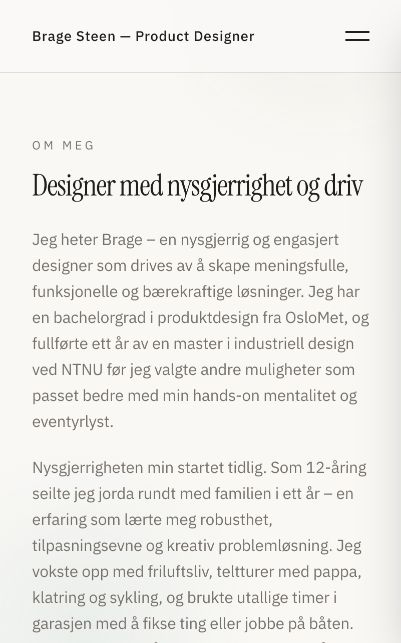

**Bestått:** Om meg og Kontakt åpner; e-postlenker finnes. Ingen e-post ble sendt.
**F16 – jobbsøkingsinnhold:** kortere profesjonell intro, relevant erfaring og en faktisk CV-lenke mangler.
Den planlagte `/cv/brage-steen-cv.pdf` ga HTML med HTTP 200 i første kontroll; dette er SPA-fallback,
ikke en tilgjengelig CV. Den private CV-originalen skal redigeres til en publiseringsklar kopi.

## Prioritering og begrensninger

Første rettingsrunde: F01/F02 navigasjon, F06 kilder/sitat, F09 produksjonsrammer,
F11 data og F15 materialpåstander. Deretter rolle, språk, CV, medievekt og de konkrete mobilfeilene.
Se [prosjektplanene](../../../PLANS.md#3-prosjektutvalg-og-rekkefølge) for tiltak og ferdigkriterier.

Dette er målrettede funksjonsprøver og en kilde-/presentasjonsgjennomgang. Ingen full
WCAG-revisjon, ytelsesbenchmark, nettbutikktest, vitenskapelig validering eller kontroll av
alle eksterne referanser er utført. Ingen av funnene er automatisk rettet i produksjon.
